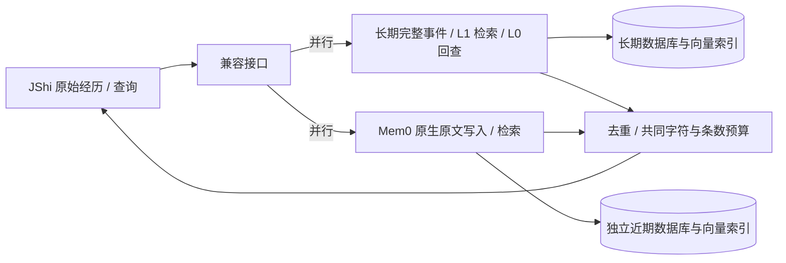

# 双库运行与真实内容评测

本副本接入 `mem0ai==2.2.1` OSS；没有修改 Mem0 包的代码。JShi 继续调用
`REMSPipeline.ingest_batch/recall`，端口、回执和回忆片段模型保持兼容。

## 两库是并行的



两个模块从同一批原始经历独立写入，没有“先近期、再迁入长期”的依赖。
查询同时发给两个模块；长期模块内部先 L1，未命中时再作 L0 词面回查。
`expand_raw=True` 可显式回查原文。L0 不删除、不强制重建一套 L0 向量；
FTS 仍包含原文，正常候选仍有对象事实和未完成事件，所以“L1 为主”不等于只剩摘要。
兼容旧库时，没有 L1 的事件暂以 L0 原文分块建索引；有 L1 后重建该事件即可切回摘要。
这不生成虚构摘要，不改写旧事件 ID、封存长度或来源关系。

采用秩次交错合并，两边同名次近期原文优先，不直接比较两个模块不同口径的分数。
重复 ID、相同交付文本、同来源且原文完全相同的命中只交付一次；
同一宽泛来源下，补充了不同细节的摘要与原文允许同时保留。
相同历史对话对象、来源类型、同一天的重复原文合并交付，保留各次来源 ID，避免不同分钟的时间标签使招呼语重复占位。
先合并再执行共同字符/条数上限，不从一条原话中间截断。多轮排序会使用融合后的分数。

一边检索异常时仍返回另一边，异常记录在日志及 `last_recall_errors`；两边异常则报错。
写入一边失败不会取消另一边。只返回两边均成功时已有的长期封存回执，
以便 JShi 重试；未封存的长事件仍等待缓冲，Mem0 单独写入不伪造长期事件 ID。
双库的实际写入/索引故障抛出 `MemoryIngestError`（带原始 result），因为现有 JShi 仅在异常分支保留游标；
仅返回 `errors` 会被它忽略。空占位经历跳过，不阻塞游标。重试还会修复已落库但未成功建立的长期索引。
来源片段身份和 Mem0 metadata 的稳定键保证重试幂等；重试可恢复已经持久化的长期回执。
这是双写重试机制，不是跨库原子事务，也不额外引入队列数据库。

## Mem0 与适配层的边界

Mem0 自己负责 `Memory.add(infer=False)`、原生嵌入器、Qdrant 存储/索引、
`Memory.search`、`Memory.delete` 和 SQLite 操作历史。
原文模式不调用 Mem0 的事实提取 LLM，不启用图记忆。没有另外实现近期检索引擎。
默认使用 Mem0 HuggingFace provider 加载 `BAAI/bge-small-zh-v1.5`，512 维。
未安装其可选关键词组件时，Mem0 自行回退到语义检索。

本项目适配层只做 JShi 字段映射、主体/对象/来源时间过滤、幂等写入、预算清理编排及结果合并。
新写入的原文按 JShi 的 origin 标注外部经历、内部记录或梦境；JShi 的 external 也包括自身已说出的回复，
不能把 external 解释成“别人说的话”。实际说话人由 JShi 输入文本前缀保留，旧记录缺少类型则不推断。
由于此版 Mem0 `get_all` 没有游标，清理枚举使用它的 Qdrant 原生分页；正常查询仍调用 Mem0 search。
Mem0 版本固定，因为维护依赖其原生 history 与 vector store 接口。

## 一年与 10 GB

| 项目 | 默认值与行为 |
|---|---|
| 时间预算 | 365 天；按来源发生时间，缺失时按写入时间 |
| 触发容量清理 | 专用近期目录实际文件总大小达到 8,000,000,000 bytes |
| 清理目标 | 最老记录优先，每批 256 条，直到不超过 7,000,000,000 bytes 或已无记录 |
| 写入容量上限 | 10,000,000,000 bytes；预估余量不足拒绝写入，实际超限撤销本次新增并报错 |
| 维护时机 | 写入前后检查；实例初始化后后台每小时检查；可调用 `maintain(force=True)` |
| 时间可见性 | 查询当时硬过滤到期内容，即使后台物理删除尚未运行 |

时间与空间任一条件满足就清理，不因“满一年”永久停止接收新记录。
预算包含专用目录中的原文、向量、metadata、SQLite/WAL、Mem0 历史及标记文件，
不包含模型缓存、长期库、备份、项目公共日志；使用十进制 GB。
这是应用层容量控制，不是文件系统硬配额：原生写入/SQLite 维护有短暂额外空间需求，
超限回滚也不能承诺磁盘占用从未瞬间超过 10 GB。

`Memory.delete` 会留下历史文本副本。为真正回收空间，发生清理时调用 Mem0 自己的 history reset
并重建原生 history manager，再执行 SQLite checkpoint/incremental vacuum。
**清理会清空近期库的操作历史，包括仍保留的记忆的历史记录；活跃记忆本身不会被 history reset 删除。**
仅删除 Qdrant 记录而保留历史文本不符合本项目的空间/时间预算。
维护期间同一 Mem0 实例读写加锁；长期模块仍可独立工作。
本地 Qdrant 目录只供单进程拥有；不要用多个 Web worker 同时打开相同目录。
10 GB 是存储预算，尚未用 10 GB 数据验证本机的内存与检索性能。

## 配置与运行

从本副本执行 `python -m pip install -e .`。已有 `.env` 和环境变量会覆盖默认值，需核对：

```dotenv
REMS_MEMORY_REFINEMENT__ENABLED=false
REMS_EVENT_MIN_CHARS=2000
REMS_EVENT_LEN_FACTOR=1.5
REMS_RECALL_EVENT_INDEX_LEVEL=L1
REMS_RECENT_MEMORY__ENABLED=true
REMS_RECENT_MEMORY__PROCESS_ISOLATION=true
REMS_RECENT_MEMORY__RETENTION_DAYS=365
REMS_RECENT_MEMORY__MAX_BYTES=10000000000
REMS_RECENT_MEMORY__CLEANUP_TRIGGER_BYTES=8000000000
REMS_RECENT_MEMORY__CLEANUP_TARGET_BYTES=7000000000
```

默认近期目录是长期 SQLite 文件旁的 `recent_memory/`；可配置 `REMS_RECENT_MEMORY__PATH`。
只接管本模块标记的专用目录，拒绝使用未标记的非空目录。
更换原生 embedder/provider/维度时需新路径；不会把新向量写入旧模型的空间。
自定义 provider 使用 `REMS_RECENT_MEMORY__EMBEDDER` JSON，维度使用 `REMS_RECENT_MEMORY__EMBEDDING_DIMS`。
结束时调用 `pipeline.close()`；HTTP 生命周期已接入关闭操作。

旧长期数据库切换 L1 后需重建索引，不能只改环境变量就认为旧数据全部可查。
在独占该测试库的进程中执行 `python scripts/reindex_qdrant.py --db <测试库.db> --qdrant-path <测试索引目录>`。
近期库不会自动复制旧的长期事件；从 JShi 原始经历回放才保留原始来源。
2026-11-17 已完成隔离验证与正式切换：长期库使用原库的副本并重建 L1 索引，
近期库从 JShi 原始经历导入；原库保留。当前正式数据目录为 JShi 的
`.jshi/rems-dual-20261117/`，其中 `recent_memory/` 由独立 Mem0 进程持有。
长期检索与原生 Mem0 检索同时执行，子进程通过适配接口返回结果。
JShi 现可通过 `--memory-module dual|legacy|inprocess` 在启动时选择模块，
配置在 JShi 的 `.jshi/memory-modules.json`，消费进度按模块隔离。
详见 JShi 的 `doc/memory-modules.md` 与本项目的 [真实漏召回修复记录](recall-fixes-20261117.md)。

长期候选默认启用有界重排：语义/词面候选中最多取 6 条进行交叉编码器重排，
保持 L1 优先，缺少 L1 的旧事件使用原文。Mem0 默认使用自身原生搜索，不启用全量候选重排。
首次部署可执行 `python scripts/setup_recall_models.py` 下载本地嵌入与重排模型；
正式运行在开放服务前预热，避免把下载或首次模型加载计入用户的第一条查询。
默认重排使用官方 AVX2 量化 ONNX 权重，需要支持对应指令的 CPU。
ONNX 计算线程数可用 `REMS_RECALL_RERANK_THREADS` 设置，通用默认 4；
当前 JShi 的 dual 配置经真实数据配对验证后使用 8，见[并行延迟优化记录](parallel-latency-20261117.md)。
随后增加显式 CPU/CUDA 选择并验证 GPU FP32。GPU 模式使用原始 PyTorch 权重，
CPU ONNX 作为可选回退；完整配置及同精度质量对照见[GPU 验证记录](gpu-20261117.md)。
不兼容的机器可将 `REMS_RECALL_RERANK_ONNX_FILE` 设为空字符串并准备对应 PyTorch 权重，
或设置 `REMS_RECALL_RERANK_ENABLED=false`，但须重新验证召回质量与性能。

## 基于实际内容的测试程序

程序：`scripts/evaluate_dual_memory.py`。样本和报告位于被 Git 忽略的 `runs/`，含真实原文，应保留在本地。
prepare 以 SQLite `mode=ro` 和 `query_only` 读取 JShi `experience_segments`，
按最新 sequence 选择实际可投递的经历，复用相邻 JShi 的转换函数处理说话人前缀、
对话对象、动作和未播出的计划语音，保留来源和发生时间，按原顺序回放。
可用 `--jshi-root` 指定实际使用的 JShi 代码。需要与实际应用保持同一个映射版本。

```powershell
python scripts/evaluate_dual_memory.py prepare --source-db ..\JShi\.jshi\subject.sqlite3 --out runs\sample\snapshot --limit 400 --max-chars 18000
python scripts/evaluate_dual_memory.py run --snapshot runs\sample\snapshot --cases runs\sample\cases.json --out runs\sample\run1 --env-file ..\JShi_memory\.env --live --max-llm-calls 30
```

prepare 生成 cases.example.json。人工核对原始记录后填写自然问法、`expected_sources` 和
`expected_quotes`，另存为 cases.json；程序检查证据确实来自该快照，不把模型猜测当标准答案。
run 只在新建测试目录写库；真实长期处理会调用模型，`--live` 显式开启，最多 30 次调用。
它覆盖长事件默认长度和 L1 配置，不继承旧实验的短事件窗口；默认不强制封存剩余短段。

三个对照组在相同字符/条数预算下查询：Mem0 单独、长期 L1 单独、并行双库。
每题默认重复 3 次，记录原始耗时与 p50/p95、来源召回率、交付文本原话覆盖率、
完整回忆材料、入库分支耗时、模型 token 用量、封存/缓冲数和近期磁盘大小。
模型冷启动单独记录；来源命中不等于细节正确，原话覆盖也不等于最终回答正确。
当前程序评测的是检索证据，不额外调用回答模型或伪造主观答案评分。

改检索参数后，可复用已完成的测试库，跳过入库和模型费用：

```powershell
python scripts/evaluate_dual_memory.py run --snapshot runs\sample\snapshot --cases runs\sample\cases.json --store-run runs\sample\run1 --out runs\sample\query2 --env-file ..\JShi_memory\.env --live
```

复用必须匹配快照指纹；仍可能写入测试库的召回轨迹，并使用当前日期作一年过滤。
`ingest.json`/`llm-usage.json` 保留实际错误；失败实验不生成冒充成功的质量得分。
小样本结果只能指导下一轮测试，不代表全量一年数据或 10 GB 的生产指标。

2026-11-16 已执行一次本地实际内容测试：400 段、16,982 字、6 个问题。
双库热检索中位 47.5 ms，交付原话覆盖 83.3%；两个单库均为 75%。
这不是回答准确率；首轮入库仍继承旧缓冲窗口，配置差异和逐题材料分析保存在
`runs/dual-actual-20261116/analysis.md`，完整记录被 Git 忽略，不随代码公开。
全量离线检查 332 passed、1 skipped；最后去重边界调整后定向 26 passed。

2026-11-17 的真实旧库检查发现早期采样映射与 JShi 投递映射不完全一致，旧分数不能作为上线验收结论。
现已修正评测映射，并补充 [旧库切换检查](cutover-audit.md) 与两个无 LLM 的检查/演练脚本。
